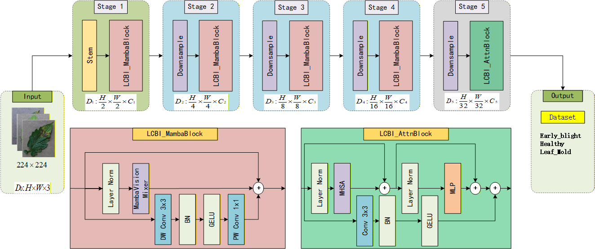

# MambaSeed: A Lightweight Mamba-Based Hybrid Vision Network for Tomato Leaf Disease Recognition

MambaSeed is a lightweight hybrid vision network for crop leaf disease
recognition. It introduces a Local Continuous Branch Injection (LCBI)
mechanism to preserve fine-grained lesion edges and textures while maintaining
efficient global dependency modeling.

> **Repository status:** The manuscript is currently under review. The complete
> source code will be released in this repository after the paper is accepted
> and before publication.

## Overview

Fine-grained disease cues such as lesion boundaries, texture variations, and
small pathological regions are essential for crop leaf recognition. Although
visual state-space models efficiently capture long-range dependencies, their
sequential feature propagation can gradually weaken these high-frequency local
cues, particularly in compact networks designed for edge deployment.

MambaSeed addresses this limitation through **Local Continuous Branch
Injection (LCBI)**. Instead of adding local information at only one layer, LCBI
repeatedly injects spatial responses throughout the feature hierarchy. This
keeps local structures involved as representations become deeper and more
semantic, while retaining the efficient global modeling path.

The network follows a five-stage hierarchical architecture. Its
**LCBI-MambaBlock** combines a MambaVisionMixer response with a lightweight
depthwise-separable convolution branch, allowing global context and local
texture information to be propagated together. At the final stage,
**LCBI-AttnBlock** combines multi-head self-attention with a parallel local
convolution pathway to balance high-level semantics and structural detail.

The design is intended to provide a compact balance among recognition
accuracy, computational efficiency, high-frequency information retention, and
robustness under illumination changes, motion blur, and spatial occlusion. The
manuscript evaluates this design on Tomato, Corn, and Potato leaf disease
datasets through classification, ablation, frequency-domain, efficiency, and
controlled-perturbation studies.

## Model Architecture

**Figure 1. Architecture of MambaSeed.**

MambaSeed follows a five-stage hierarchical design. The LCBI-Mamba block
combines state-space global modeling with a depthwise-separable local
convolution branch. The final stage uses an LCBI-Attention block to integrate
global semantic information and local visual details.

## Code Availability

The current public snapshot contains the paper overview and model architecture
figure only. It does not contain source code, trained weights, datasets,
training scripts, or experiment outputs.

The complete source code required to use the proposed model will be made
publicly available in this repository after manuscript acceptance and before
publication. During peer review, code access can be provided to editors and
reviewers when required for assessment.

## Citation

The final bibliographic record and DOI will be added after publication.

## Content License

The repository description and architecture figure are available under the
Creative Commons Attribution 4.0 International license. A separate software
license will be added when the source code is released.
